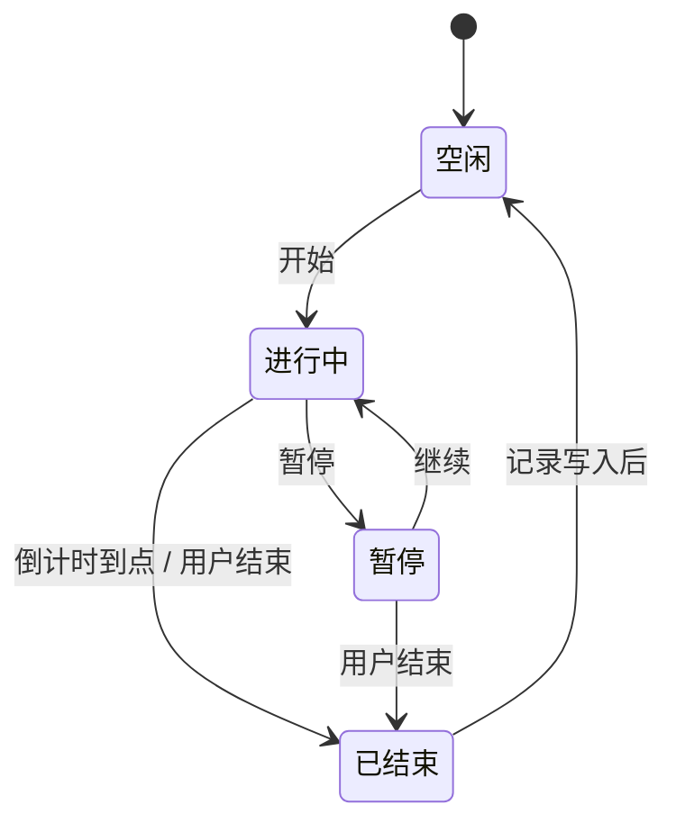

# Aside 落地文档

这份文档讲三件事：代码放在哪里、有哪些功能、每个功能在什么情况下怎么用、背后的流程是什么。界面细节和视觉规范见 `product-plan.md`，外观稿见 `mockups/`。

## 1. 目录

```
Aside/
├─ docs/                  产品方案、本文档、外观稿和概念图
├─ src/                   前端（React + TypeScript），所有窗口共用一套代码
│  ├─ app/                入口；根据地址里的 ?view= 决定这个窗口显示哪个界面
│  ├─ views/              四类窗口各自的界面
│  │  ├─ main/            主窗口：开始、记录、科目、设置
│  │  ├─ overlay/         全屏计时页、结束页
│  │  ├─ mini/            浮窗：胶囊样式和 Q 版形象
│  │  └─ lecture/         网课窗口右侧的侧栏
│  ├─ features/           按功能拆分的前端业务：计时、科目、记录、氛围、形象等
│  ├─ shared/             跨窗口通用的东西：主题、基础组件、界面音效、调用后端的封装
│  └─ assets/             打包进 app 的素材：字体、内置声音、背景画面、内置形象包
└─ src-tauri/             后端（Rust）
   ├─ src/
   │  ├─ timer/           计时状态机，所有窗口的时间都从这里来
   │  ├─ store/           本地 SQLite 数据和版本迁移
   │  ├─ windows/         全屏窗口、浮窗、网课窗口的创建和切换，多显示器
   │  ├─ system/          托盘或菜单栏、全局快捷键、开机自启、阻止休眠、勿扰
   │  ├─ media/           用户导入的声音、图片、形象包
   │  ├─ lecture/         网课网页和“只看视频”
   │  └─ commands/        给前端调用的命令入口
   ├─ capabilities/       每个窗口能用哪些系统权限
   ├─ icons/              应用图标
   └─ tauri.conf.json     应用名、主窗口、打包配置
```

运行时产生的数据不在仓库里，放在系统给 app 的数据文件夹中（macOS 是 `~/Library/Application Support/com.aside.app/`，Windows 是 `%APPDATA%\com.aside.app\`）：

```
data.db        科目、记录、设置
sounds/        导入的背景音
scenes/        导入的背景图片
characters/    导入的形象包
```

三条约定：

- **时间只有一个来源**：计时由后端 `timer` 负责，前端各窗口只负责显示后端广播的时间，自己不计时。
- **前端不直接碰数据库和系统**：都通过 `commands` 调后端。
- **界面跟着功能走**：新功能的前端业务放在 `features/` 下，界面拼装放在 `views/` 下。

## 2. 功能总览

文中的用户故事都以同一个人为例：**小林**，准备 2027 年考研，考计算机（政治、英语一、数学一、408）。白天在图书馆刷题，晚上在宿舍看网课。

| 功能 | 阶段 |
|---|---|
| 3.1 开始一段专注 | M1 |
| 3.2 计时、暂停与恢复 | M1 |
| 3.3 全屏计时页 | M1，多显示器在 M2 |
| 3.4 结束与备注 | M1 |
| 3.5 科目管理 | M1 |
| 3.6 界面音效 | M1 |
| 3.7 浮窗 | M2 |
| 3.8 托盘、快捷键、开机自启 | M2 |
| 3.9 某一天的记录与补记 | M3 |
| 3.10 统计总览 | M3 |
| 3.11 模考 | M3 |
| 3.12 氛围：背景画面、背景音 | M4 |
| 3.13 导入自己的背景音和图片 | M4 |
| 3.14 每日一句与考研倒计时 | M4 |
| 3.15 勿扰 | M4 |
| 3.16 周报卡片 | M4 |
| 3.17 网课模式 | M5 |
| 3.18 Q 版形象 | M6 |

## 3. 功能

### 3.1 开始一段专注

**用户故事**：早上八点，小林在图书馆坐下，打开 Aside。科目默认是“其他”，他点成“数学”。他选好倒计时 90 分钟、显示方式“全屏”，在任务里写“二重积分 第三章习题”，点“开始专注”，把笔记本电脑立在桌角，开始低头做题。

**流程**：

1. 打开开始页时，科目默认选中“其他”，方式、时长、显示方式沿用上一次的选择。
2. 用户可以改科目、方式（倒计时 / 正计时 / 模考）、时长（1 分钟到 24 小时），以及显示方式（默认全屏，也可以选浮窗）。任务可以不填。
3. 点“开始专注”，或按全局快捷键。
4. 后端检查当前没有正在进行的专注，记下开始时刻、计划时长、科目和任务，状态变为“进行中”。
5. 主窗口隐藏，按显示方式打开全屏页或浮窗。
6. 播放“开始”音效，按设置开启勿扰和背景音。

**规则**：

- 同一时间只能有一段专注。已经在专注时，快捷键的作用变成“结束”。
- 点“再来一段”回到开始页时，沿用上一段的科目。

### 3.2 计时、暂停与恢复

**用户故事**：做到一半，室友喊小林去接水。他晃一下鼠标点“暂停”，回来后点“继续”。中午他合上电脑去吃饭，忘了暂停，回来打开电脑，时间依然是对的：合盖的那段算在专注里，因为他没有暂停。

**流程**：



1. 后端只保存三样东西：本轮开始时刻、之前累计的专注时长、计划时长。
2. 每秒向所有窗口广播一次：已专注多久、还剩多久、当前状态。
3. 暂停时，把本轮时长加进累计，停止累加。继续时，记下新的本轮开始时刻。
4. 倒计时到点时，后端自动切到“已结束”，触发结束流程（3.4）。
5. 正计时满 24 小时自动结束。

**规则**：

- 时间按“当前时刻减开始时刻”计算，不依赖界面里的定时器，所以睡眠、锁屏、窗口被遮挡都不会让时间变慢。
- 暂停的时间不算专注。
- app 意外退出后再打开，如果发现有一段没结束的专注，就按最后一次心跳的时刻自动结束并记下，开始页提示“上次有一段专注已记下”。

### 3.3 全屏计时页

**用户故事**：小林把电脑放在一米外的桌角，屏幕上只有一行很大的“32:48”，下面一条细细的天际线在慢慢变亮。他抬头扫一眼就知道还剩半小时，不用伸手碰电脑。他外接了一块显示器，那块屏幕也一起暗了下来，没有任何东西分散注意力。

**流程**：

1. 开始专注且显示方式是“全屏”时，后端为每个显示器各开一个全屏窗口。主屏显示计时内容，其他屏幕只显示同色背景。
2. 计时期间阻止系统休眠和屏保。
3. 页面每秒接收后端广播并刷新时间和天际线。
4. 鼠标静止 3 秒，控件全部淡出。移动鼠标时，淡入“暂停、氛围、缩成浮窗、结束”四个文字按钮。
5. 点“缩成浮窗”，关掉所有全屏窗口，打开浮窗，计时不中断。
6. 内容每隔几分钟整体漂移几个像素，防止烧屏。

### 3.4 结束与备注

**用户故事**：九十分钟到了，屏幕慢慢亮起来，一声很轻的铃音由小变大。小林抬头看见“这一段学了 90 分钟，已经记下了。”他想起第 3 题没做出来，在下面的“加个备注”里写“第 3 题没想通，明天问”，然后点“再来一段”。

**流程**：

1. 进入“已结束”状态有两种情况：倒计时到点，或者用户点了“结束”。
2. 后端计算实际专注时长：
   - 不到 1 分钟的不记录，界面只提示“这一段太短，没有记下”。
   - 1 分钟及以上，写入一条记录（科目、模式、开始结束时刻、专注时长、任务）。
3. 倒计时到点时，背景在 3 秒内变亮，铃声从很小的音量开始，30 秒内渐强，最多重复 3 次。用户在电脑前做任何操作，铃声立即停止。用户主动结束时不响铃，只播放一声轻柔的“结束”音效。
4. 全屏页切换成结束页，显示时长、科目和任务，并提供“再来一段”“回到电脑”和“加个备注”。
5. 填了备注就更新到刚才那条记录上。不填也没关系，备注默认为空。
6. 关闭背景音，按设置关闭勿扰。
7. 点“再来一段”回到开始页，沿用刚才的选择；点“回到电脑”关闭全屏，主窗口回到开始页。

**规则**：结束页和所有提示都不出现“失败”“未完成”这类字眼。提前结束和到点结束，说法完全一样。

### 3.5 科目管理

**用户故事**：小林发现“专业课”太笼统，想把 408 拆开看。他在科目页把“专业课”改名为“数据结构”，又新增了“计组”“操作系统”“计网”，各选一个颜色。之前记在“专业课”名下的时间，现在显示在“数据结构”下面。

**流程**：

1. 首次启动时预置五个科目：政治、英语、数学、专业课、其他。
2. 可以新增、改名、改颜色、拖动排序。
3. 不再用的科目可以归档：归档后不出现在开始页，但历史记录和统计里还在，随时能恢复。
4. “其他”是兜底科目，只能改颜色，不能改名和归档。
5. 没有删除。避免一次误操作就让几个月的记录失去归属。

### 3.6 界面音效

**用户故事**：晚上宿舍很安静，小林点科目、选时长时，每下都有一声很轻的木质“嗒”，点“开始专注”是两声由低到高的柔和音。这些声音让他觉得操作“落了地”，但声音小到不会吵到上铺。

**流程**：

1. 每个能点的控件都声明自己属于哪一类：普通点击、切换、开始、暂停、继续、结束、删除确认。
2. 点击时，前端用 Web Audio 实时合成对应的声音并播放。不用音频文件，所以没有授权问题，也不占体积。
3. 音量和开关在设置里单独调，默认打开、音量 40%。
4. 用全局快捷键开始或结束时，也播放同样的声音。

### 3.7 浮窗

**用户故事**：小林要用电脑查一道题的解析，不想关掉计时。他晃一下鼠标点“缩成浮窗”，全屏页收成右上角一个小胶囊，显示“数学 32:48”。查完以后，他点胶囊上的“展开”回到全屏。

**流程**：

1. 显示方式选“浮窗”，或者在全屏页点“缩成浮窗”，后端打开一个置顶、透明、无边框的小窗口。
2. 浮窗显示科目和时间，底边有一条细进度线。
3. 浮窗可以拖动。松手时记住位置，下次在同一个地方出现。
4. 鼠标悬停时出现四个按钮：暂停、氛围、展开到全屏、结束。
5. 按快捷键可以在全屏和浮窗之间来回切换。

### 3.8 托盘、快捷键、开机自启

**用户故事**：小林把 Aside 设成开机自启。早上开机后，它只安静地待在菜单栏里。他直接按 `⌥⌘S` 开始专注，开始页都不用打开。专注期间，菜单栏上显示着剩余时间“32:48”，他在别的软件里也能瞄到。

**流程**：

1. app 启动后常驻托盘（Windows）或菜单栏（macOS）。关闭主窗口只会隐藏它，不会退出。
2. 托盘菜单有三项：开始或结束、显示主窗口、退出。
3. 专注期间：
   - macOS 菜单栏直接显示剩余时间。
   - Windows 托盘图标画一圈进度，鼠标悬停时显示剩余时间。
4. 两个全局快捷键：
   - 开始或结束：macOS 为 `⌥⌘S`，Windows 为 `Ctrl+Alt+S`。用快捷键开始时，沿用开始页上一次的选择。
   - 全屏和浮窗互相切换：macOS 为 `⌥⌘M`，Windows 为 `Ctrl+Alt+M`。
5. 设置里可以修改快捷键。新快捷键和其他软件冲突时，明确提示冲突，并保留旧的快捷键。
6. 开机自启默认关闭。打开后，开机时只出现在托盘里，不弹出主窗口。

### 3.9 某一天的记录与补记

**用户故事**：周日晚上，小林想看看周三那天到底怎么过的。他在记录页点热力图上周三的格子，看到一条 0 点到 24 点的时间轴：上午一大段绿色的数学，下午几小段英语，晚上空着。他想起周三晚上在自习室看的纸质书没开计时，于是点“补记一段”，补上“19:30–21:00 政治”。

**流程**：

1. 记录页默认显示今天。可以用 ‹ › 切换日期，也可以点开日历任选一天。点热力图的格子或趋势图的柱子，同样会跳到那一天。
2. 上方的时间轴按开始和结束时刻画出每一段专注，颜色是科目颜色，没学的时间留空。
3. 下方按时间顺序列出这一天的每一段：起止时间、科目、任务、时长、备注。补记的带“补记”标记。
4. 点一条记录可以修改科目、时间、任务、备注，也可以删除。删除前需要确认。
5. 补记一段：选科目、日期、开始时间、时长，备注可选。
   - 补记的时间不能和已有记录重叠，重叠时提示和哪一条冲突了。
   - 补记不能晚于当前时刻。
6. 一段专注跨过零点时，统计按零点拆到两天，记录本身仍是一条，两天的时间轴上都能看到它。

### 3.10 统计总览

**用户故事**：月底，小林打开记录页的“总览”。这个月他学了 21 天，数学占了一大半，英语这周少一些。没学的那几天在热力图上只是空格，没有一块是红的。看完以后他心里有数，而不是愧疚。

**流程**：

1. **今日**：总时长和各科目占比。
2. **趋势**：最近 7 天和本月每天的柱状图，按科目分颜色叠在一起。设了每日目标的话，画一条淡淡的参考线。
3. **热力图**：最近 16 周，颜色越深表示学得越久，没学的日子留空。
4. **本周 / 本月学了几天**：只统计学了的天数，不显示连续天数，断一天也不清零。
5. **科目平衡**：用一句陈述说明哪个科目时间最多、哪个偏少，不催促、不给建议。

### 3.11 模考

**用户故事**：周六上午，小林要做一套 2023 年数学一真题。他在开始页选“模考”，科目选数学，时长自动填成 180 分钟。他关掉手机，在纸上答题。三小时到了，结束页多了一个分数输入框，他对完答案填上 112 分。

**流程**：

1. 方式选“模考”时，时长按科目自动填入考研真题时长（四科都是 180 分钟），可以手动改。
2. 计时、暂停、结束和普通倒计时完全一样。
3. 结束页多一个可选的分数输入框，满分默认 150（政治 100、英语 100、数学 150、专业课 150），可以修改。
4. 分数和这条记录关联保存。记录页这条记录上带“模考”标记和分数。

### 3.12 氛围：背景画面、背景音

**用户故事**：晚上十点，宿舍楼下有点吵。小林在开始页右侧的氛围面板里点了“雨窗”和“雨声”，预览图马上变成雨夜。专注了半小时，他觉得雨声有点腻，晃一下鼠标点“氛围”，时间下方淡出“画面 / 声音”两组文字，他点了“篝火”，雨声在两秒内慢慢换成了柴火噼啪声，计时一秒也没停。

**流程**：

1. **开始页**：右侧固定一栏氛围面板，有预览、背景画面、背景音（带音量），点一下立即生效，预览同步变化。字色跟着画面走，晨雾用深色字。
2. **专注中**：
   - 全屏页点“氛围”，时间上移，下方淡入两组文字选项，没有弹框。
   - 鼠标悬停在画面上时，直接在页面上预览，点击才算选定。
   - 声音只在点击时切换。
   - 浮窗里也有一个声音入口。
3. **快捷键**：全屏页里 `B` 换画面、`N` 换声音、`↑` / `↓` 调音量。
4. **切换效果**：
   - 背景画面 1.2 秒交叉淡化。
   - 背景音 2 秒交叉渐变。
   - 切换完成后，顶部淡入一行小字“换成了 篝火”。
5. 专注中换的就是正式设置，下一段沿用，没有“只对这一段生效”的临时状态。
6. 界面固定用夜读配色，不再单独选风格。

### 3.13 导入自己的背景音和图片

**用户故事**：小林最习惯家里书房那台老电扇的声音。他用手机录了十分钟，传到电脑上，在背景音最后点“＋ 导入”，选中这个文件，起名“老电扇”。之后它就和雨声、篝火排在一起。他又导入了一张高中教室的照片当背景，Aside 自动把它压暗了一些，白色的时间依然看得清。

**流程**：

1. 点背景音或背景画面最后的“＋ 导入”，选择文件。
   - 声音支持 mp3、m4a、wav、flac，单个文件最大 200MB。
   - 图片支持 jpg、png、webp。
2. 后端检查格式和大小，不符合就明确说明原因，比如“不支持 .ape 格式，可以先转成 mp3”。
3. 把文件复制一份到数据文件夹，原文件之后移动或删除都不影响。
4. 声音额外做两件事：
   - 测量响度，自动调到和内置声音差不多大（可以在设置里关闭）。
   - 决定循环方式：10 分钟以内的解码后无缝循环；更长的边播边读，首尾 2 秒交叉渐变。
5. 图片额外生成一张压暗、轻微模糊的版本，用作背景。
6. 导入的项目可以改名和删除，在列表里带“我的”标记。

### 3.14 每日一句与考研倒计时

**用户故事**：小林每天开始第一段专注时，全屏页底部换了一句新的话，比如今天是“题会做完的，不急在这一道。”他一直没打开考研倒计时，因为看到“还剩 68 天”会心慌。他室友喜欢这种压力感，就在设置里打开了，室友的开始页顶部多了一行小字。

**流程**：

1. 内置约 120 句话，按日期轮换，同一天内不变。
2. 句子显示在全屏页底部和结束页。
3. 考研倒计时默认关闭。在设置里填考试日期并打开后，只在开始页顶部显示一行小字，不出现在全屏页、浮窗和网课侧栏。

### 3.15 勿扰

**用户故事**：小林用的是 Mac。他按设置里的引导，在“快捷指令”里建了“打开专注模式”和“关闭专注模式”两个指令。之后每次开始专注，微信和邮件的通知都自动静音了，结束后自动恢复。

**流程**：

1. **macOS**：
   - 设置里提供一步一步的引导，用户在“快捷指令”里建好两个指令，并把指令名称填回 Aside。
   - 开始专注时，后端运行“打开”指令；结束时运行“关闭”指令。
   - 指令运行失败时，在开始页提示一次原因，比如“找不到名为‘打开专注模式’的快捷指令”。
2. **Windows**：系统没有可用的接口，开始专注时提示一次“可以按 Win+N 打开勿扰”，并提供“不再提示”。

### 3.16 周报卡片

**用户故事**：周一早上，小林打开 Aside，开始页提示“上周的周报好了”。他点开，看到一张竖版卡片：“这一周，你坐下来了 5 天，21 小时 40 分”，四个科目的进度条，还有一句话。他点“保存为图片”，发到了考研群里，和研友互相打气。

**流程**：

1. 每周一第一次打开 app 时，如果上周有记录，就在开始页提示一次。
2. 卡片内容：日期范围、学了几天、总时长、各科目时长、7 天的分布圆点、一句话。
3. 卡片不包含任务和备注，可以放心分享。
4. “换一句话”换卡片上的句子，“保存为图片”导出 PNG。
5. 记录页“这一周”卡片上的“查看周报”，可以随时打开本周或往期的周报。

### 3.17 显示方式

显示方式只有全屏和浮窗，默认全屏。浮窗可以按住形象、时间或空白处拖到任意位置。网课模式已去掉。

### 3.18 Q 版形象

**用户故事**：小林把浮窗样式换成了企鹅“嘎嘎”。专注时它坐在屏幕角落低头看书，偶尔眨眼；他点暂停去接水，企鹅举起两只翅膀伸了个懒腰；时间到时它扑腾着翅膀，气泡里冒出“嘎嘎！”。后来他在网上找到别人做的形象包，在设置里点“导入形象”，就换上了。

**流程**：

1. 设置里的“浮窗样式”可以选企鹅（默认）、胶囊（不显示形象）或导入的形象。专注中也能在浮窗的氛围入口里换。
2. 后端扫描内置目录和数据文件夹的 `characters/`，读出每个形象包的 `character.json`，列出可选的形象。
3. 根据计时状态播放对应的动画：专注中、暂停、最后 5 分钟、时间到。系统开启“减少动态效果”时只播放眨眼。
4. 浮窗可以按住形象、时间气泡或空白处拖动，松手后记住位置。
5. **导入形象包**：
   - 选一个文件夹或 `.zip`，后端检查是否缺状态图、帧数是否对得上、图片是否过大。
   - 有问题时，说明是哪个文件出了什么问题；通过后复制到数据文件夹。
6. 浮窗底部也显示当前形象，动画规则相同。

## 4. 开发环境

- Node.js 20+ 和 pnpm。
- Rust：通过 [rustup](https://rustup.rs) 安装稳定版。
- macOS 需要 Xcode Command Line Tools；Windows 需要 Microsoft C++ Build Tools 和 WebView2（Windows 10/11 一般自带）。

```bash
pnpm install
pnpm tauri dev     # 启动桌面应用（前端热更新，后端改动自动重新编译）
pnpm build         # 只检查类型并构建前端
```

开发时可以在浏览器里单独打开某个窗口的界面：`http://localhost:1420/?view=overlay`，`view` 可选 `main`、`overlay`、`mini`。
